<h1 align="center">🍝 eFood — Massas frescas, direto da trattoria</h1>

<p align="center">
  <strong>Plataforma de delivery de massas artesanais das melhores trattorias.</strong><br />
  Escolha a trattoria, monte o pedido e receba em casa — ou passe para retirar, sem taxa de entrega.
</p>

<p align="center">
  
  
  
  
  
</p>

<p align="center">
  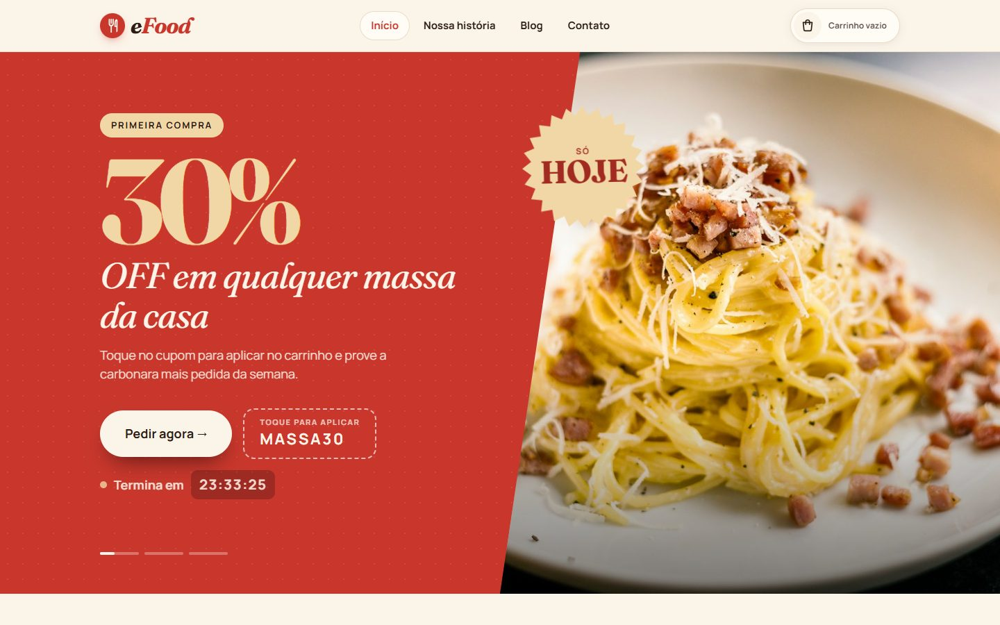
</p>

---

## 📌 Sobre o projeto

O **eFood** é um site de delivery focado em **massas artesanais**. A pessoa encontra trattorias perto de casa, navega pelo cardápio, adiciona pratos ao carrinho e finaliza o pedido — recebendo em casa ou retirando no local — tudo em uma interface pensada para dar **fome só de olhar**.

O projeto partiu de um [layout base no Figma](https://www.figma.com/design/JjduV2Tg713TzYUUsees8b/efood) e foi **redesenhado do zero**: nova paleta inspirada na cozinha italiana (vermelho tomate, verde manjericão, amarelo trigo), tipografia editorial com **Fraunces + Manrope**, animações e várias funcionalidades que não existiam no original.

> 💡 Projeto de estudo/portfólio. Restaurantes, preços, avaliações, depoimentos e selos são fictícios, e o pagamento é apenas simulado.

---

## ✨ Funcionalidades

| | |
|---|---|
| 🎯 **Banner de promoções** | Carrossel em tela cheia com troca automática, selo animado, **cupom aplicado no carrinho com um toque** e **contagem regressiva** até a meia-noite |
| 🎟️ **Cupom de boas-vindas** | Card em destaque com **30% OFF no 1º pedido** logo na home — um toque e o cupom já entra no carrinho |
| 📍 **Perto de você** | Abas **Delivery** e **Retirar no local**, busca por bairro, tempos de entrega/preparo e **mapa ilustrado com pinos** que reagem ao passar o mouse |
| 🍽️ **Cardápio** | **42 pratos exclusivos**, sem repetição entre as 6 trattorias: lasanhas, massas recheadas (ravioli, tortellini, cappelletti), massas longas e curtas, e sobremesas (tiramisù, panna cotta, cannoli, gelato…). Selos de promoção e **modal de detalhes** (fecha com `Esc` ou clicando fora) |
| 🛒 **Carrinho global** | Gaveta lateral em todas as páginas, **promoções calculadas de verdade** (leve 2, pague 1, combo e cupom de 30%), **barra de progresso** até o frete grátis e itens salvos ao recarregar |
| 🛵 **Entrega ou retirada** | Escolha entre **receber em casa** (frete grátis acima de R$ 80) ou **retirar no local** sem taxa — a escolha vale para o site todo |
| 💳 **Checkout em etapas** | Entrega/Retirada → Pagamento → Confirmação, com **validação de campos** e **máscaras** de CEP, telefone e cartão |
| 📖 **Nossa história** | Página com **animações ao rolar**: números que contam sozinhos, linha do tempo que se preenche e galeria em movimento |
| 📰 **Blog** | Lista com filtro por categoria, post em destaque e página individual para cada artigo |
| ✉️ **Contato** | Formulário validado, canais de atendimento e perguntas frequentes |
| 🏅 **Rodapé** | Selos de confiança e prêmios, links das páginas e redes sociais |
| 📱 **Responsivo** | Layout pensado para celular, tablet e desktop, com menu hambúrguer no mobile |
| ♿ **Acessível** | HTML semântico, navegação por teclado, `aria-*` nos componentes interativos e respeito à preferência de **movimento reduzido** |

---

## 🖼️ Telas

<table>
  <tr>
    <td width="50%">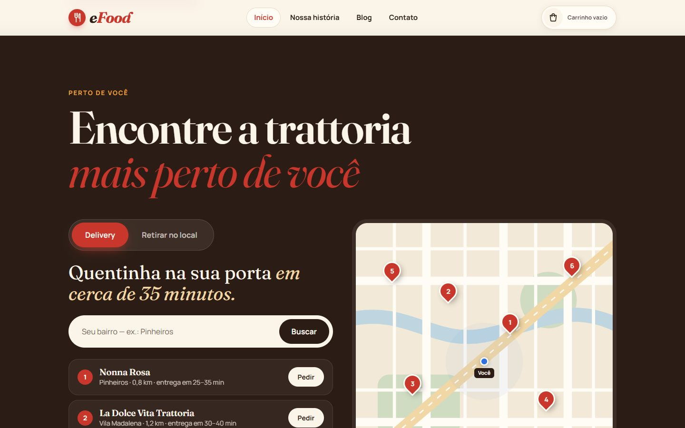</td>
    <td width="50%">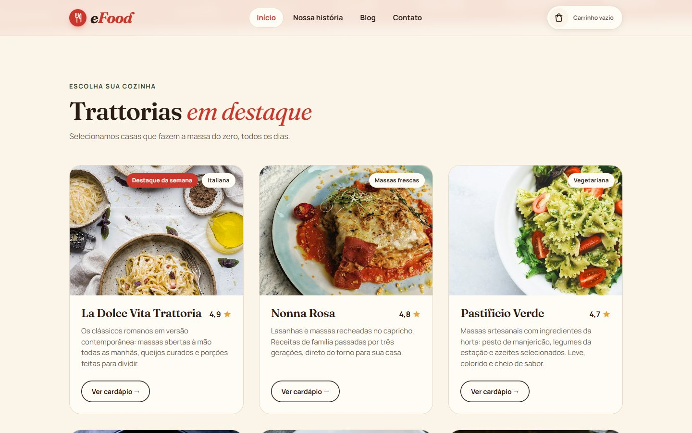</td>
  </tr>
  <tr>
    <td align="center"><sub><b>Perto de você</b> — delivery ou retirada, com mapa interativo</sub></td>
    <td align="center"><sub><b>Trattorias em destaque</b></sub></td>
  </tr>
  <tr>
    <td>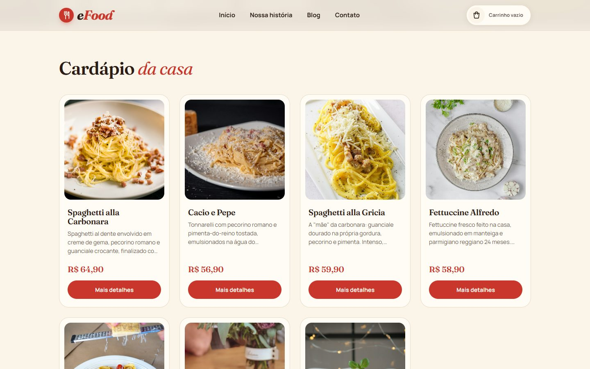</td>
    <td>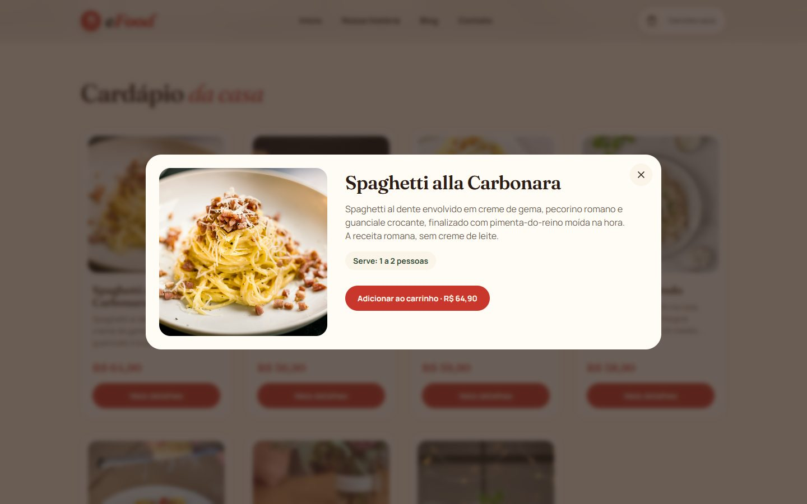</td>
  </tr>
  <tr>
    <td align="center"><sub><b>Cardápio</b> da trattoria</sub></td>
    <td align="center"><sub><b>Detalhes do prato</b> em modal</sub></td>
  </tr>
  <tr>
    <td>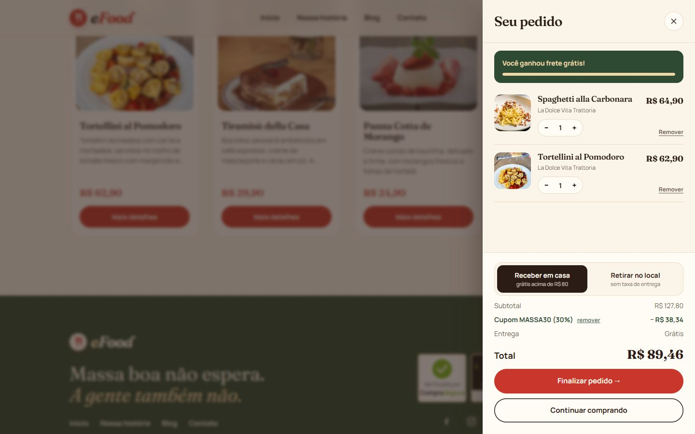</td>
    <td>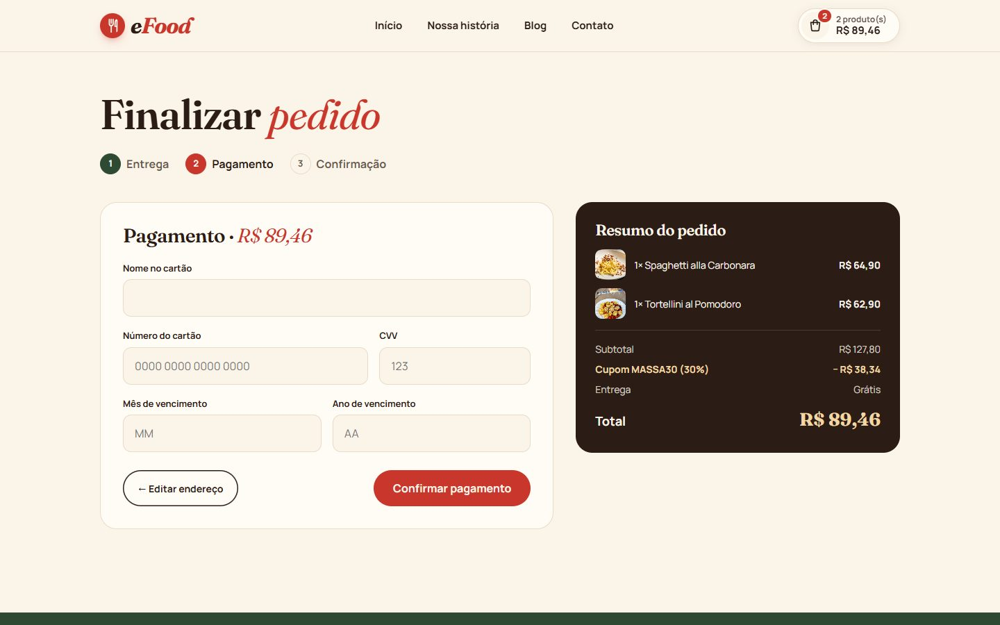</td>
  </tr>
  <tr>
    <td align="center"><sub><b>Carrinho</b> com cupom, metas e escolha entre entrega ou retirada</sub></td>
    <td align="center"><sub><b>Checkout</b> em etapas com resumo do pedido</sub></td>
  </tr>
  <tr>
    <td>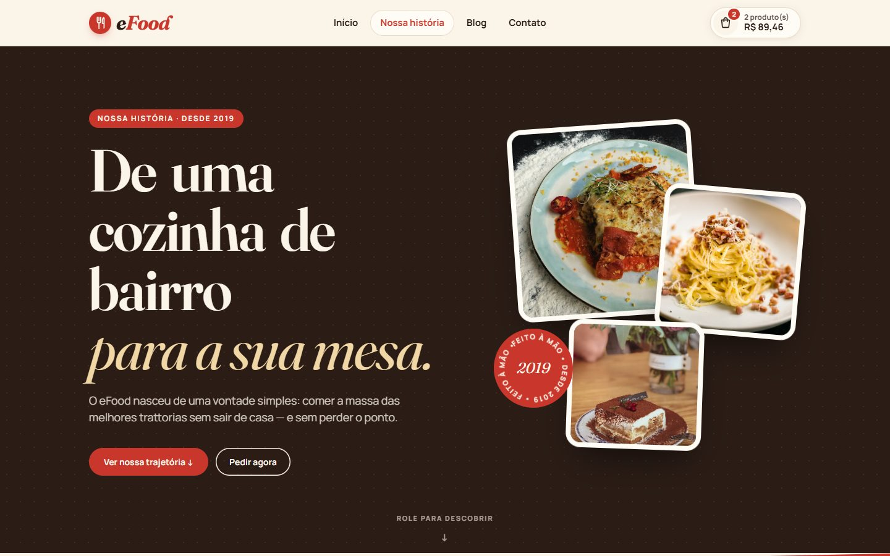</td>
    <td>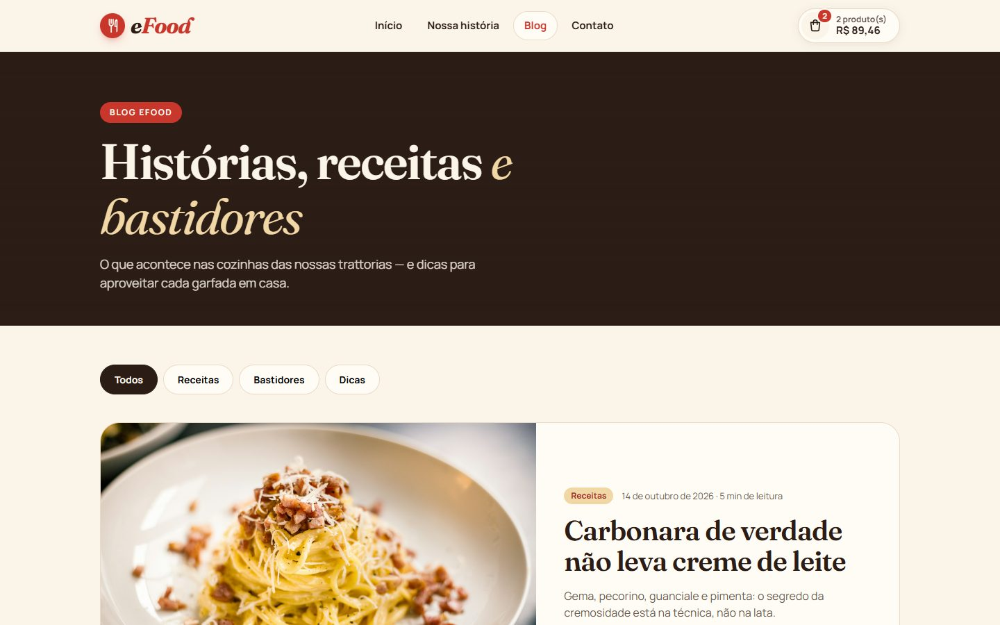</td>
  </tr>
  <tr>
    <td align="center"><sub><b>Nossa história</b> com animações ao rolar</sub></td>
    <td align="center"><sub><b>Blog</b> com filtro por categoria</sub></td>
  </tr>
</table>

### 📱 No celular

<p align="center">
  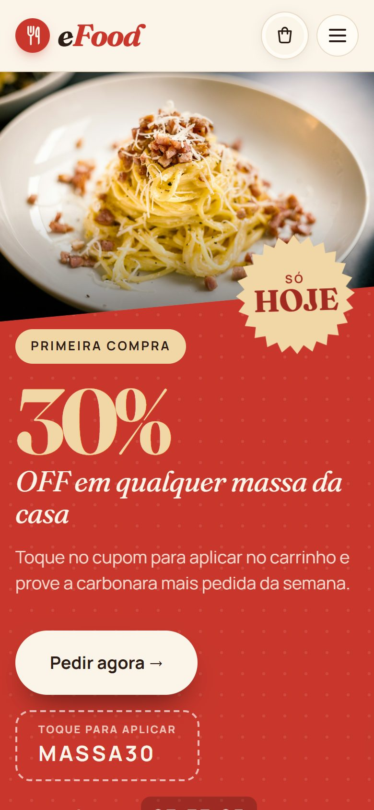
  &nbsp;
  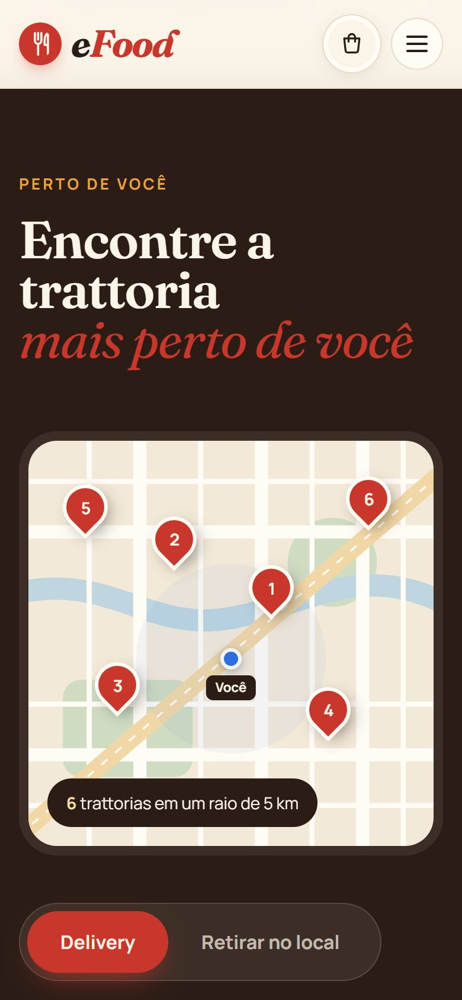
  &nbsp;
  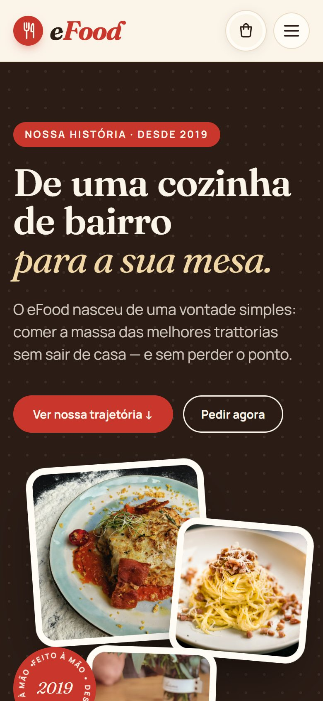
</p>

---

## 🛠️ Tecnologias

- **[React 19](https://react.dev/)** + **[TypeScript](https://www.typescriptlang.org/)** — componentes tipados de ponta a ponta
- **[styled-components](https://styled-components.com/)** — estilos isolados por componente, tema com tokens de cor e estilo global
- **[React Router](https://reactrouter.com/)** — navegação entre páginas, rotas dinâmicas (`/perfil/:id`, `/blog/:slug`) e link ativo no menu
- **Context API** — estado global do carrinho, persistido no `localStorage`
- **IntersectionObserver** + `requestAnimationFrame` — animações de entrada e contadores sem bibliotecas externas
- **[Vite](https://vite.dev/)** — ambiente de desenvolvimento e build
- **[Oxlint](https://oxc.rs/)** — análise de código

---

## 🧠 Destaques técnicos

- **Zero bibliotecas de animação:** carrossel, gaveta, contadores, revelação ao rolar e linha do tempo feitos com CSS + hooks próprios ([`useNaTela`](src/hooks/useNaTela.ts), [`Revelar`](src/componentes/Revelar/), [`Contador`](src/componentes/Contador/)).
- **Carrossel sincronizado com a barra de progresso:** a troca de slide acontece no `onAnimationEnd` da barra, então pausar e retomar nunca dessincroniza.
- **Carrinho resiliente:** Context + `useMemo`/`useCallback` para evitar renderizações desnecessárias, e `try/catch` no `localStorage` para funcionar até em janela anônima.
- **Linha do tempo sem re-render:** o preenchimento ao rolar é feito com uma variável CSS (`--progresso`) atualizada direto no DOM.
- **Design system enxuto:** cores, fontes e breakpoints centralizados em [`src/styles`](src/styles/index.ts).

---

## 📂 Estrutura de pastas

```
src/
├── assets/images/   # fotos e ícones SVG
├── componentes/     # cada parte do site: index.tsx + styles.ts
├── contexto/        # estado global do carrinho
├── data/            # restaurantes, promoções, posts e depoimentos
├── hooks/           # hooks reutilizáveis
├── pages/           # Home, Perfil, Checkout, Nossa história, Blog, Post, Contato
├── styles/          # estilo global e tokens de design
├── routes.tsx       # rotas da aplicação
└── App.tsx
```

---

## 🚀 Como rodar

Pré-requisito: **[Node.js](https://nodejs.org/) 20+**

```bash
# clone o repositório
git clone https://github.com/FlaviaaMenegossi/projeto-efood.git
cd projeto-efood

# instale as dependências
npm install

# rode em modo desenvolvimento
npm run dev
```

Abra **http://localhost:5173** no navegador.

| Comando | O que faz |
|---|---|
| `npm run dev` | Inicia o servidor de desenvolvimento |
| `npm run build` | Gera a versão de produção em `dist/` |
| `npm run preview` | Serve a versão de produção localmente |
| `npm run lint` | Verifica o código com o Oxlint |

> 🎟️ Dica: na página inicial, toque no cupom **MASSA30** do banner para ganhar 30% OFF — ou leve 2 lasanhas da Nonna Rosa e pague só 1.

---

## 👩‍💻 Autora

Feito com 🍝 e muito ☕ por **Flavia Menegossi**.

[](https://github.com/FlaviaaMenegossi)
<!-- Para adicionar o LinkedIn, troque SEU-USUARIO e remova os marcadores de comentário desta linha:
[](https://www.linkedin.com/in/SEU-USUARIO/)
-->

<sub>Fotos: [Unsplash](https://unsplash.com/) · Layout base: Figma eFood</sub>
